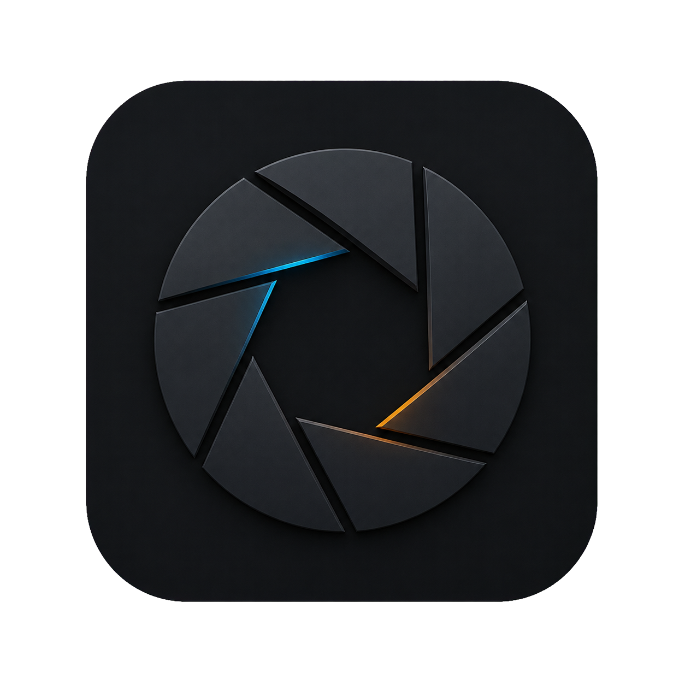
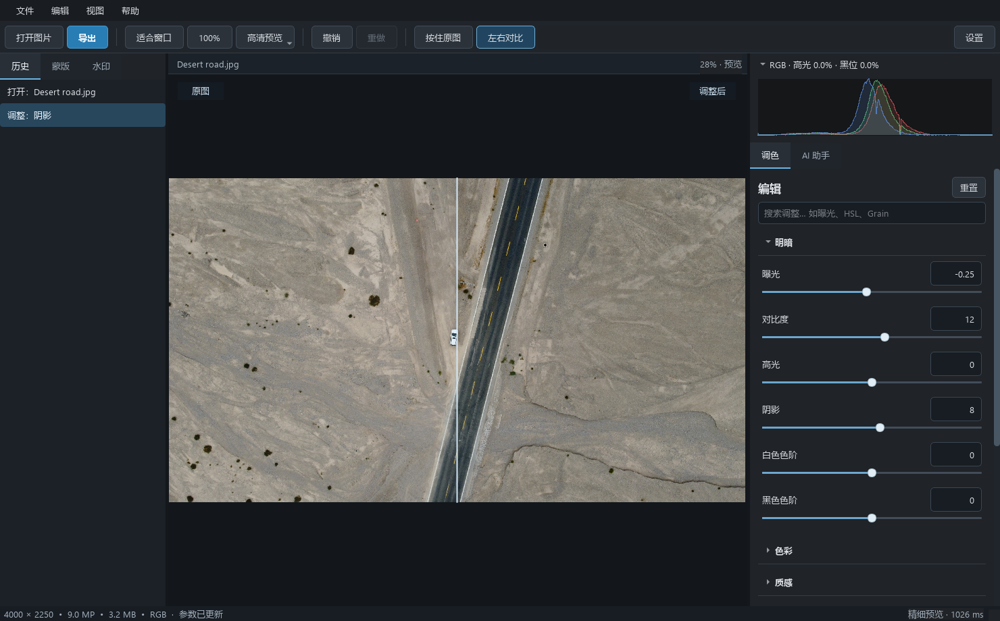
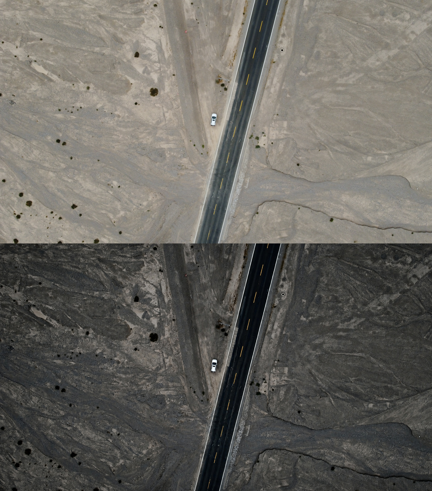

# AI Lightroom

[简体中文](README_zh-CN.md)

  

AI Lightroom is a Windows desktop photo editor for non-destructive traditional adjustments and optional natural-language AI colour-grading plans. The local renderer applies supported parameters, HSL, curves, masks, and watermarks; it does not redraw or generate a replacement photograph.

## Features

- JPG/PNG import, drag-and-drop, recent files, zoom, fit, 100%, histogram, before/after, undo/redo, and crash-recovery sessions.
- Real-time Basic adjustments, HSL, RGB/channel curves, colour grading, masks, brush masks, and non-destructive watermark layers.
- Full-resolution JPG/PNG export with available EXIF, ICC, and DPI metadata.
- One shared `EditingPlan` and `EditorState` for manual controls and every AI provider.
- Provider registry: JarvisArt Local GGUF, Gemini, OpenAI, Qwen/DashScope, DeepSeek text adjustments, Custom OpenAI-compatible API, and Offline Mock.
- Cloud safeguards: no automatic retry, one cloud request per user action by default, and a local daily safety limit.

## Installation

Download the Windows x64 installer or ZIP from the GitHub Releases page. The installer is the easiest option; for the ZIP, extract the **whole** archive and run `AI Lightroom.exe`. No AI account is required for manual editing.

For source setup, see [Installation](docs/INSTALLATION.md) and [Building](docs/BUILDING.md). Beginner guides are available in [English](docs/GETTING_STARTED.md) and [简体中文](docs/GETTING_STARTED_zh-CN.md).

## Quick start

1. Open or drag a JPG/PNG into the app.
2. Adjust sliders, HSL, curves, masks, or watermarks. Double-click a slider to reset it; enter exact values in its value field.
3. Export with `Ctrl+S` or `Ctrl+Shift+S`. Original files are never overwritten by default.
4. Optionally configure an AI provider in **File → Settings** and use `Ctrl+Enter` to send an AI prompt.

## Preview quality / 预览质量

Use the **Low preview / High preview** button in the toolbar, or **File → Settings → Performance & Export**, to choose the working-preview size. High quality rebuilds a larger local preview; when a visual request is needed, the AI receives a JPEG preview using the independently configured AI image-quality setting.

- **Automatic** (default): cloud providers use low quality to limit transfer and cost; **JarvisArt Local GGUF** uses high quality because it runs locally.
- **Low**: default maximum edge is 1536 px.
- **High**: default maximum edge is 3072 px; both limits are editable in Settings.
- Incremental text-only requests may intentionally omit an image. This preserves the existing state-aware cost safeguard.

## AI providers

AI Lightroom does not proxy photos or API keys through a project server. Each cloud provider uses the account and key configured by the user.

| Provider | Vision | Cost/privacy | Notes |
| --- | --- | --- | --- |
| JarvisArt Local GGUF | Yes | Local, no API fee | User-supplied local GGUF bridge; high preview by default; see [JarvisArt](docs/JARVISART.md). |
| Google Gemini | Yes | Cloud preview, provider quota/cost | User-configured model ID. |
| OpenAI | Yes | Cloud preview, provider cost | User-configured model ID. |
| Qwen / DashScope | Yes | Cloud preview, provider quota/cost | Default endpoint can be changed. |
| DeepSeek | No | Text + edit state only | Intended for incremental text edits; no first-pass image analysis. |
| Custom OpenAI-compatible | User declared | User configured | Base URL, key, model, optional organization and safe custom headers. |
| Offline Mock / JarvisArt Mock | Fixture | Local, free | Development-only fixture. It cannot inspect a photograph and is blocked from real editing. |

### JarvisArt Local

JarvisArt Local GGUF is an optional, user-supplied localhost runtime and is not included in this repository or release. AI Lightroom connects only to its local bridge and sends a temporary local preview over loopback. It defaults to the high-quality size; this can be changed in Settings. The GGUF, llama.cpp runtime, and any model license remain separate. See [JarvisArt Local](docs/JARVISART.md).

#### Example: a restrained cinematic aerial grade

  

Top: original. Bottom: the locally applied result. The request was: “Give this image a cool, hard-edged, low-saturation cinematic look. Darken it slightly overall, strengthen terrain texture and road separation, keep the white subject clear, and avoid excessive HDR.” It is a useful example of a specific photographic direction with a preservation constraint, rather than a generic “make it better” request. The full prompt, interface reference, and interpretation are in [JarvisArt Local](docs/JARVISART.md).

### Custom API

Choose **Custom / OpenAI-compatible API** in Settings and supply a Provider Name, Base URL, API Key, and Model ID. Vision and structured output switches are declarations by the user; only enable capabilities the target service actually supports. The app rejects custom `Authorization` headers so API keys remain in Windows Credential Manager. See [Custom API](docs/CUSTOM_API.md).

## Privacy and cost

- The editor works with no API key.
- Cloud calls send only a configured capped JPEG preview and edit state, never the original full-resolution image.
- Real local JarvisArt and Offline Mock do not use the cloud budget manager. Mock is a blocked development fixture, not an image-analysis option.
- API keys are stored separately in Windows Credential Manager (environment variables can override them), never in the project configuration, logs, release package, or source control.
- A cancelled cloud request may already have reached the provider and may count as one call.

## Keyboard shortcuts

| Shortcut | Action |
| --- | --- |
| `Ctrl+O` | Open image |
| `Ctrl+S` / `Ctrl+Shift+S` | Export / Export as |
| `Ctrl+Z` | Undo |
| `Ctrl+Y` or `Ctrl+Shift+Z` | Redo |
| `\` or hold **Original** | Before/after |
| `F` / `1` | Fit / 100% |
| Mouse wheel | Zoom image (sliders ignore the wheel) |
| `Ctrl+Enter` | Send AI request |
| `Enter` | New line in AI prompt |

## Documentation

- [Getting started (English)](docs/GETTING_STARTED.md) · [中文新手完整指南](docs/GETTING_STARTED_zh-CN.md)
- [Installer guide (English)](docs/INSTALLER.md) · [安装包说明](docs/INSTALLER_zh-CN.md)
- [User guide](docs/USER_GUIDE.md)
- [AI providers](docs/AI_PROVIDERS.md) · [AI Provider 中文说明](docs/AI_PROVIDERS_zh-CN.md)
- [Custom API](docs/CUSTOM_API.md) · [自定义 API 中文说明](docs/CUSTOM_API_zh-CN.md)
- [Provider development](docs/PROVIDER_DEVELOPMENT.md) · [Provider 开发说明](docs/PROVIDER_DEVELOPMENT_zh-CN.md)
- [Architecture](docs/ARCHITECTURE.md) · [架构](docs/ARCHITECTURE_zh-CN.md)
- [Troubleshooting](docs/TROUBLESHOOTING.md) · [故障排除](docs/TROUBLESHOOTING_zh-CN.md)

## Roadmap and limitations

This release supports JPG/PNG, not a RAW workflow. Local semantic masks are conservative OpenCV analysis rather than a large segmentation model. JarvisArt's current localhost bridge returns global Lightroom parameters; unsupported native Lightroom operations remain visible and are never silently applied. See the [CHANGELOG](CHANGELOG.md) for the release scope.

## License and credits

AI Lightroom source code is released under the [MIT License](LICENSE). Third-party notices are in [THIRD_PARTY_NOTICES.md](THIRD_PARTY_NOTICES.md). JarvisArt and its model are separate optional components governed by their own license; this project does not redistribute either one. AI Lightroom is not affiliated with or endorsed by Adobe.
