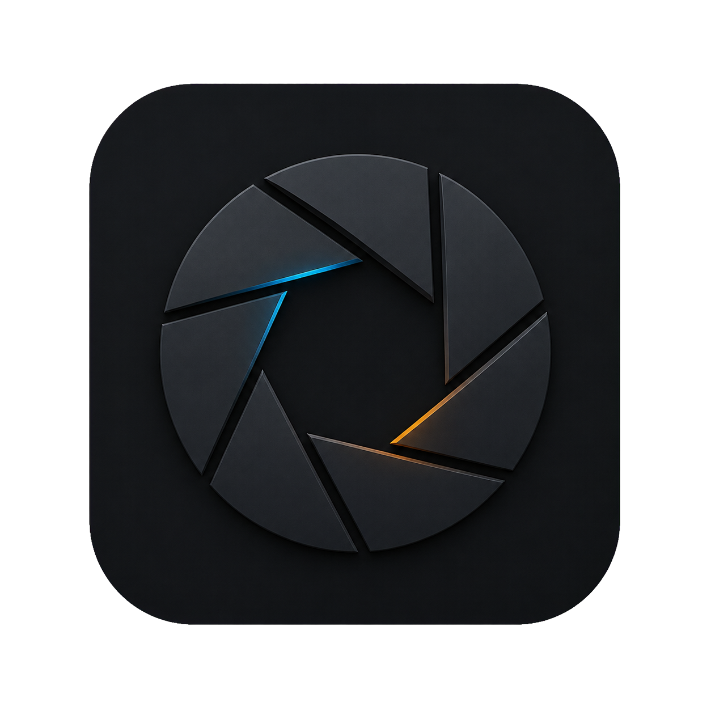
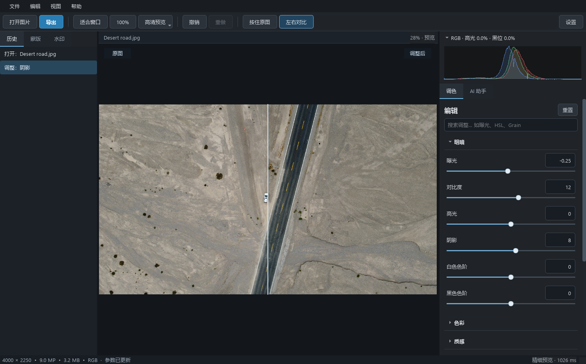
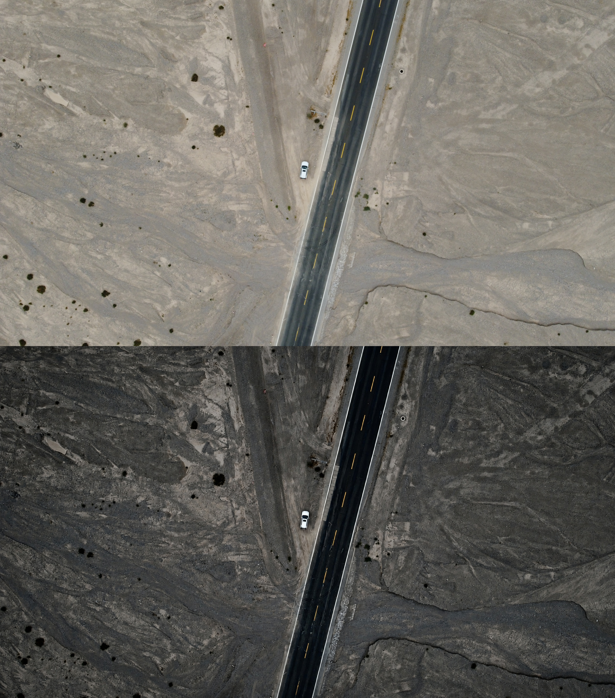

# AI Lightroom

[English](README.md)

  

AI Lightroom 是一款 Windows 桌面照片编辑器：传统参数调色与自然语言 AI 调色共用同一套非破坏性编辑状态。AI 只会返回可验证的编辑方案；真正的像素处理由本地渲染器完成，绝不会用生成式模型重绘你的照片。

## 先从这里开始

第一次使用、安装包、云端 AI 配置、JarvisArt 模型下载、导出和常见错误，请直接看：

**[中文新手完整指南](docs/GETTING_STARTED_zh-CN.md)** · [English getting-started guide](docs/GETTING_STARTED.md)

日常使用可先看[手动修图与文字调色示例](docs/EDITING_WORKFLOWS.md)。当前打包版本为 v1.0.3。

## 已支持的功能

- JPG / PNG 导入、拖入打开、缩放、适合窗口、直方图、原图对比、撤回/重做与编辑恢复。
- 实时基础参数、HSL、RGB/通道曲线、色彩分级、局部蒙版、画笔蒙版和非破坏性水印。
- 从原始全分辨率照片渲染导出 JPG / PNG，并尽量保留 EXIF、ICC 与 DPI。
- Gemini、OpenAI、Qwen / DashScope、DeepSeek 文本增量、Custom OpenAI-compatible、JarvisArt Local GGUF 与离线 Mock。
- API 调用默认无自动重试；云端调用有本地每日安全上限。

## 三种使用方式

| 你想做什么 | 需要什么 | 从哪里开始 |
| --- | --- | --- |
| 纯手动修图 | 无账号、无 API Key | 下载后直接运行即可。 |
| 使用云端 AI 调色 | 对应服务商的 API Key | 在 **文件 → 设置 → AI** 选择 Provider 并测试连接。 |
| 本地运行 JarvisArt | 独立安装的 JarvisArt、模型与本地桥接服务 | 阅读 [JarvisArt 本地部署与连接说明](docs/JARVISART_zh-CN.md)。 |

## JarvisArt Local 效果示例

  

上方为原图，下方为本地应用后的结果。使用的提示词是：“把这张照片调成冷峻、硬朗、低饱和的电影感。整体稍微压暗，加强地表纹理和道路层次，白色主体保持清晰，不要过度 HDR。”它展示了如何同时给出明确的视觉方向和保护条件，而不是笼统地要求“修得更好”。完整提示词、界面示意和结果解读见 [JarvisArt 本地部署与连接说明](docs/JARVISART_zh-CN.md)。

## 快速操作

1. 从 GitHub Releases 下载 Windows 安装包或 ZIP；安装包最简单，ZIP 必须完整解压后再运行。
2. 打开或拖入 JPG / PNG 照片。右侧滑块、HSL、曲线、蒙版与水印都可直接使用。
3. `Ctrl+S` 导出。默认不会覆盖原始照片。
4. 如需 AI，在 **文件 → 设置** 配置 Provider；AI 输入框中 `Ctrl+Enter` 发送，`Enter` 换行。

## 预览质量与 AI 发送质量

工具栏的 **低清预览 / 高清预览** 按钮可以立即切换工作画布；也可在 **文件 → 设置 → 性能与导出** 中选择。

- **自动（默认）**：云端 Provider 默认低清，减少上传和费用；**JarvisArt Local GGUF** 默认高清，因为它在本机运行。
- **低清** 默认最长边为 1536 px；**高清** 默认最长边为 3072 px；两个数值都可以修改。
- “发送给 AI 的图像质量”可独立选择“跟随画布 / 始终低清 / 始终高清”。发生视觉分析时，AI 只会收到该大小的 JPEG 预览，不会收到原始全分辨率照片。
- “弱一点”“退一点”这类纯文字增量请求可能不会再传图，这是为了延续已有的费用保护；需要重新看图时请明确说“重新看看”。

## 隐私、费用与许可

- 不配置 API Key 也可以完整手动修图。
- 云端 AI 只接收缩小的 JPEG 预览和当前编辑状态；原始全分辨率照片始终保留在本机。
- API Key 存在 Windows Credential Manager，不写入源码、日志、发布包或 Git。
- JarvisArt Local GGUF 是用户自行安装的本地运行时，模型、llama.cpp 与许可证不随本项目分发。只有 **Local GGUF** 才会进行真实本地推理；**Mock** 是固定开发样例，软件会阻止它用于真实调色。
- AI Lightroom 代码采用 [MIT License](LICENSE)；第三方说明见 [THIRD_PARTY_NOTICES.md](THIRD_PARTY_NOTICES.md)。本项目与 Adobe 没有隶属或认可关系。

## 文档

- [中文新手完整指南](docs/GETTING_STARTED_zh-CN.md) · [English getting-started guide](docs/GETTING_STARTED.md)
- [安装包说明](docs/INSTALLER_zh-CN.md) · [Installer guide (English)](docs/INSTALLER.md)
- [JarvisArt 本地部署与连接说明](docs/JARVISART_zh-CN.md)
- [AI Provider 说明](docs/AI_PROVIDERS_zh-CN.md) · [English](docs/AI_PROVIDERS.md)
- [自定义 OpenAI-compatible API](docs/CUSTOM_API_zh-CN.md) · [English](docs/CUSTOM_API.md)
- [故障排除](docs/TROUBLESHOOTING_zh-CN.md) · [English](docs/TROUBLESHOOTING.md)
- [安装与源码运行](docs/INSTALLATION_zh-CN.md) · [Windows 打包](docs/BUILDING_zh-CN.md)
- [架构](docs/ARCHITECTURE_zh-CN.md) · [Provider 开发说明](docs/PROVIDER_DEVELOPMENT_zh-CN.md)
