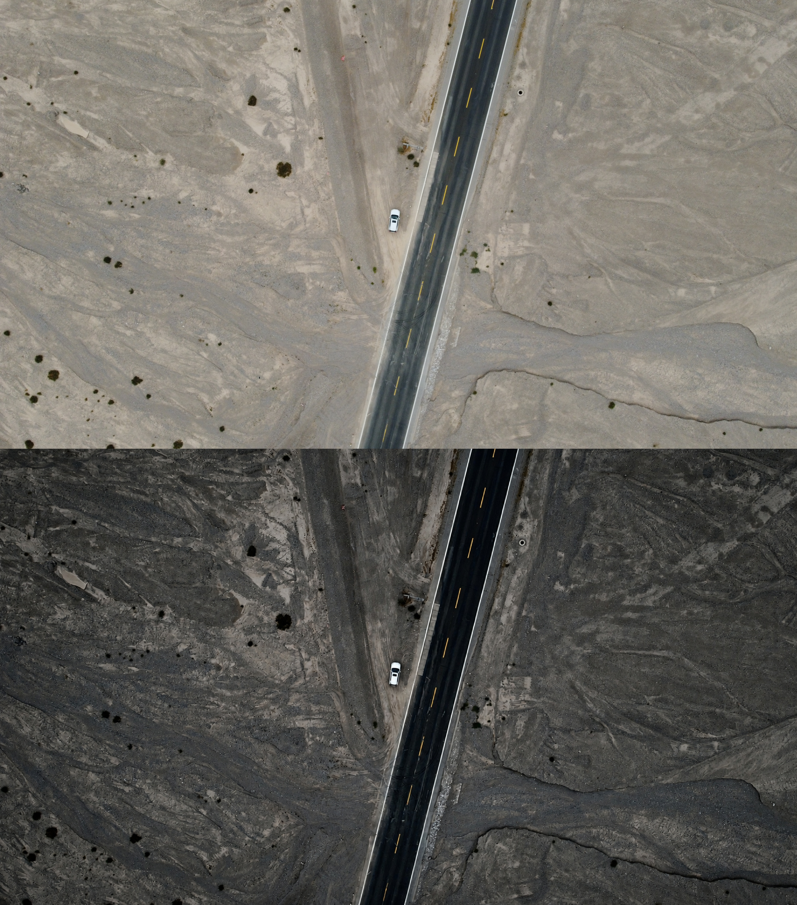

# JarvisArt Local GGUF

[中文部署与连接说明](JARVISART_zh-CN.md)

JarvisArt Local GGUF is an optional user-supplied localhost provider. AI Lightroom does not bundle, download, move, or license any GGUF, llama.cpp runtime, JarvisArt code, or model weights.

## Requirements

Install your local GGUF runtime under any directory that contains its existing `scripts/launch_services.ps1` launcher and compatible local backend. In AI Lightroom choose **JarvisArt Local GGUF → Local GGUF**, optionally set the root directory and endpoint (default `http://127.0.0.1:8765`), then select **Start JarvisArt** or make the first JarvisArt request. Do not use **Mock Native** for a real edit: it is a fixed development fixture, cannot inspect a photograph, and the application blocks it from applying a demonstration plan.

The provider checks `/health`, starts only the selected existing launcher, and connects through localhost. It sends a temporary configured low/high JPEG preview to the bridge and removes that temporary file immediately after the request. Automatic quality defaults to High for Local GGUF (3072 px maximum edge by default); both the working preview and separate AI input quality are editable in **File → Settings → Performance & Export**. It does not upload the original photo or count against cloud AI usage.

## Lifecycle

The settings panel reports Offline, Loading, Ready, or Error. **Stop and release GPU** stops only processes launched by the current AI Lightroom process; shared services started by Lightroom Classic or another tool are not killed. Closing AI Lightroom has the same ownership rule.

## Current bridge scope

The current JarvisArt local bridge returns Lightroom global parameters and some HSL parameters. AI Lightroom maps supported settings to `EditingPlan` and lists unsupported Lightroom operations instead of silently pretending to apply them. Native local masks and Lightroom-only operations remain a future bridge capability.

Use only a local GGUF/runtime that you are permitted to use. If your model derives from JarvisArt or another project, read and follow that upstream project's license before use.

## Example: restrained cinematic aerial grade

  
   
  <em>Top: original. Bottom: local JarvisArt result.</em>

**Prompt used**

> Give this image a cool, hard-edged, low-saturation cinematic look. Darken it slightly overall, strengthen terrain texture and road separation, keep the white subject clear, and avoid excessive HDR.

The request is deliberately constrained: it specifies the intended mood and the desired structural separation while keeping a white subject legible and explicitly rejecting an exaggerated HDR result. The output is a darker, more restrained grade with stronger ground/road separation; it does not alter composition or fabricate new content.

## In-app reference / 应用内界面示意

  
   
  <em>Reference workflow: inspect the result, refine the prompt, then compare the recorded plan before keeping the edit.</em>

The screenshot illustrates the application workflow, not a claim that every native Lightroom Classic panel is embedded in AI Lightroom. A practical loop is to inspect the result, submit one focused follow-up request, and use history/undo to compare the validated plan with the prior non-destructive state.
