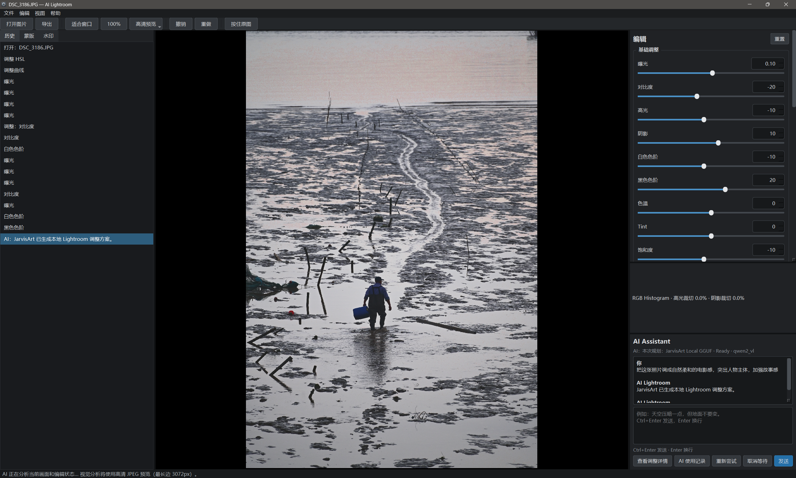

# JarvisArt Local GGUF

[中文部署与连接说明](JARVISART_zh-CN.md)

JarvisArt Local GGUF is an optional user-supplied localhost provider. AI Lightroom does not bundle, download, move, or license any GGUF, llama.cpp runtime, JarvisArt code, or model weights.

## Requirements

Install your local GGUF runtime under any directory that contains its existing `scripts/launch_services.ps1` launcher and compatible local backend. In AI Lightroom choose **JarvisArt Local GGUF → Local GGUF**, optionally set the root directory and endpoint (default `http://127.0.0.1:8765`), then select **Start JarvisArt** or make the first JarvisArt request. Do not use **Mock Native** for a real edit: it is a fixed development fixture, cannot inspect a photograph, and the application blocks it from applying a demonstration plan.

The provider checks `/health`, starts only the selected existing launcher, and connects through localhost. It sends a temporary configured low/high JPEG preview to the bridge and removes that temporary file immediately after the request. Automatic quality defaults to High for Local GGUF (3072 px maximum edge by default); both the working preview and separate AI input quality are editable in **File → Settings → Performance & Export**. It does not upload the original photo or count against cloud AI usage.

## Lifecycle

The settings panel reports Offline, Loading, Ready, or Error. Closing AI Lightroom leaves the local service running so other clients can continue using it. To stop a service deliberately, use **文件 → 设置 → AI 服务 → 停止并释放显存 / File → Settings → AI service → Stop and release GPU**. This stops only processes launched by the current AI Lightroom process; services owned by Lightroom Classic or another launcher are not killed.

## Lightroom Classic coexistence

A Lightroom Classic plugin may use the same localhost JarvisArt bridge as AI Lightroom. The two clients should share the service rather than each starting an unrelated second model process. AI Lightroom therefore treats an already healthy bridge as reusable and does not terminate a process it did not launch.

If the Lightroom Classic plugin is configured to start its bridge automatically when Lightroom opens, AI Lightroom can attach to the same endpoint after `/health` reports Ready. Conversely, if AI Lightroom launched the bridge first, a compatible Lightroom plugin can reuse that running endpoint. Keep one agreed root directory and endpoint to avoid duplicate services, port conflicts, and unnecessary GPU memory use.

Lightroom Classic menu placement, Develop-module invocation, and keyboard-shortcut bindings belong to the Lightroom plugin rather than this repository. They may be configured independently without changing AI Lightroom's provider settings.

## Current bridge scope

The current local bridge returns Lightroom Develop parameters. The adapter supports the implemented tone, HSL, RGB/channel curves, detail/noise, vignette/grain, defringe, geometry, calibration, and colour-grading controls. It parses the data without executing Lua, validates the plan, and applies it through the same local renderer as manual edits.

Unknown operations remain listed in adjustment details. An invalid response or a plan with no usable operations is not presented as a successful edit. Lightroom-specific rendering, lens profiles, Lens Blur, Point Color, and Generative Remove are not reproduced by this renderer; native local masks also depend on what the separate bridge can return.

In 1.1, open the right **AI 助手 / AI Assistant** tab to send a request and inspect its details. Conflicting edits are disabled until the request completes, and the applied plan is one undo step. Use `C` for the draggable original/result comparison. The fast preview used while dragging sliders follows the performance mode (Balanced 1280 px by default, Battery 768 px, Fine interaction 1600 px); it does not reduce the independently configured AI image size.

Use only a local GGUF/runtime that you are permitted to use. If your model derives from JarvisArt or another project, read and follow that upstream project's license before use.

## Example: restrained cinematic aerial grade

  
   
  <em>Top: original. Bottom: local JarvisArt result.</em>

**Prompt used**

> Give this image a cool, hard-edged, low-saturation cinematic look. Darken it slightly overall, strengthen terrain texture and road separation, keep the white subject clear, and avoid excessive HDR.

The request is deliberately constrained: it specifies the intended mood and the desired structural separation while keeping a white subject legible and explicitly rejecting an exaggerated HDR result. The output is a darker, more restrained grade with stronger ground/road separation; it does not alter composition or fabricate new content.

## In-app reference / 应用内界面示意

  
   
  <em>Reference workflow: inspect the result, refine the prompt, then compare the recorded plan before keeping the edit.</em>

This reference image shows an earlier workspace layout. In 1.1, the prompt lives in the right **AI 助手 / AI Assistant** tab. Inspect the result, submit a focused follow-up, and use history/undo or split comparison before keeping the edit.
